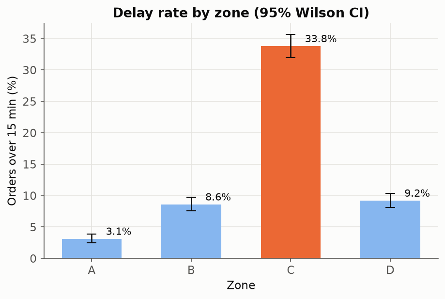
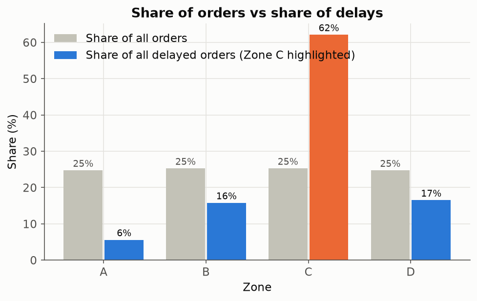
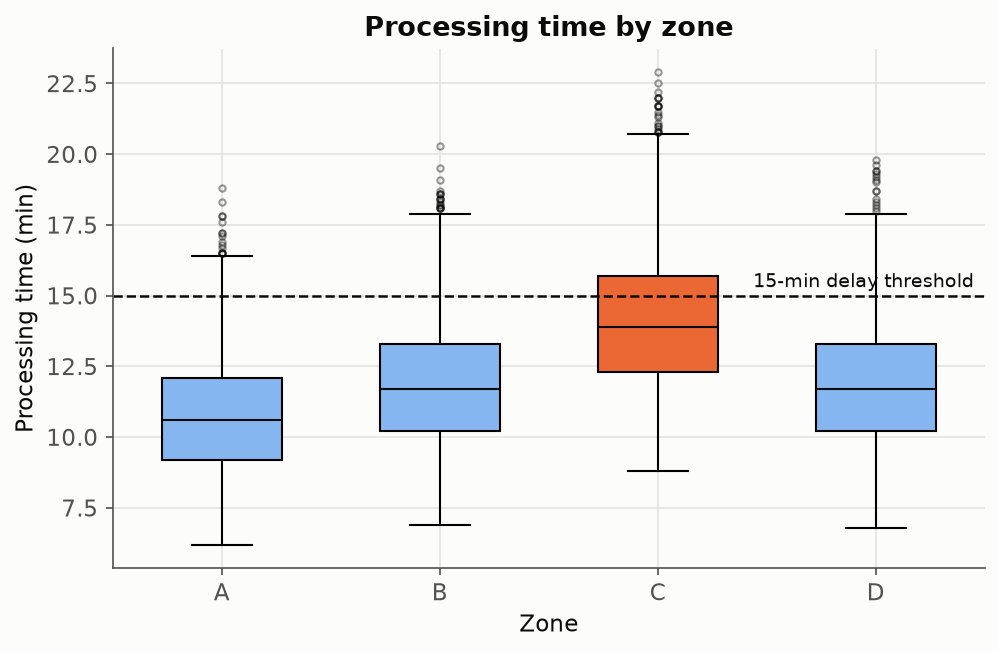
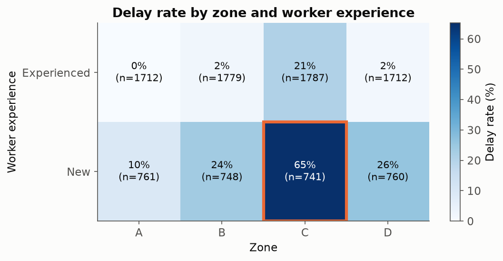
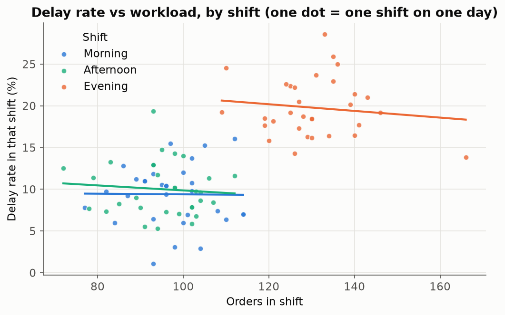
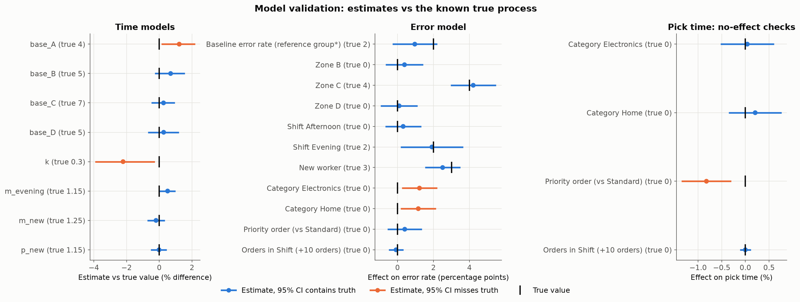
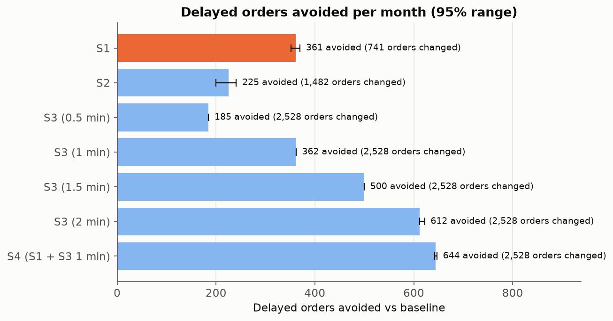
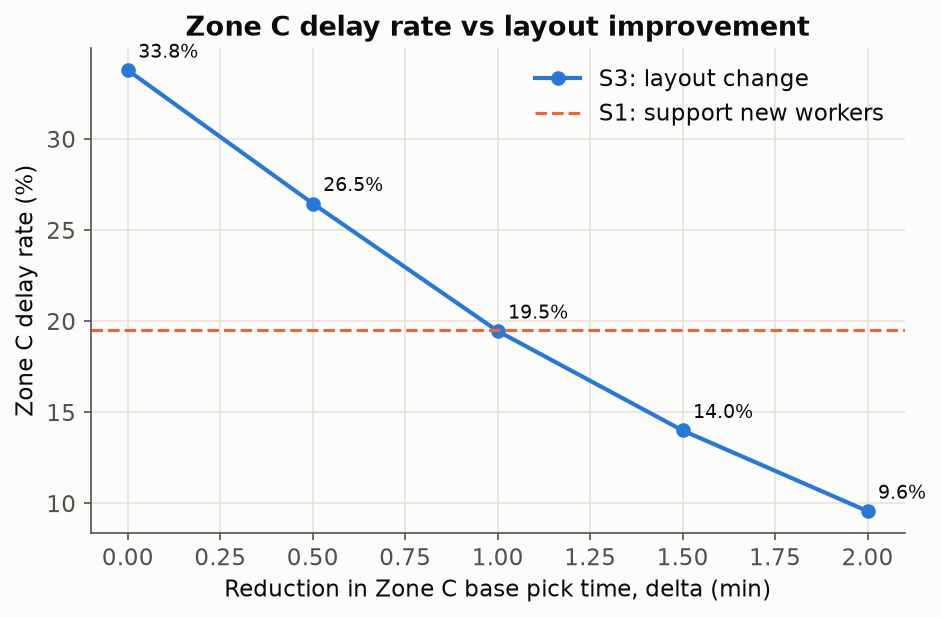
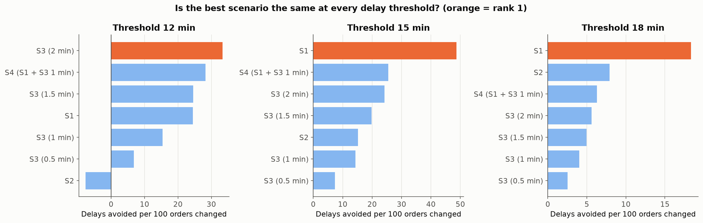

# Warehouse Operations Analysis: from symptoms to root cause to a tested fix


A reproducible Python analysis of 10,000 synthetic warehouse orders. It finds where processing time is lost, separates the real root cause from look-alike patterns, **checks the statistical model against the known process that generated the data**, and simulates operational changes using effects measured from the data rather than invented percentages. Everything (tables, charts, this page's numbers and the report) is produced by one command.

## Key results

<!-- The block below is generated by run_analysis.py. Do not edit by hand. -->
<!-- BEGIN:key_results -->
> - **10,000 orders**, **13.8% delayed** (>15 min), mean processing time **12.1 min**.
> - **Zone C** handles 25% of orders but **62% of all delays**.
> - **Root cause:** New workers in Zone C are delayed on **65%** of orders vs 21% for experienced workers there. They handle 7.4% of orders but cause **35.1% of all delays**.
> - **Workload is a confounder:** once shift is controlled for, 10 extra orders in a shift change the delay rate by -0.35 pp (95% CI -1.03 to 0.32, p = 0.31).
> - **Validated model:** 10 of 12 built-in parameters have a 95% CI containing the true value; pick-time model R² = 0.80 (out-of-sample 0.80).
> - **Best first step:** Support New workers in Zone C (S1) avoids **361 delayed orders a month** (95% range 352-370) by changing only 741 orders.
<!-- END:key_results -->

---

## The question

> **Where does the warehouse lose time, what is the real root cause, and which operational change would reduce delays most?**

The project moves step by step: describe the data → find the root cause → separate the effects with a model that is **validated against known true parameters** → simulate changes using the measured effects → recommend a change and design a trial to test it.

## Dataset

- `data/raw_data.csv`: 10,000 orders from August 2026. **Synthetic data generated in Excel. It is not real company data.**
- Columns: Order Id, Date, Shift (Morning/Afternoon/Evening), Zone (A-D), Product Category, Items (1-10), Priority, Pick Time, Pack Time, Processing Time (= Pick + Pack, minutes), Error (Yes/No), Worker Experience (New/Experienced), Orders in Shift.
- A **delayed** order is one with Processing Time **over 15 minutes**. This is an assumption, set in [`warehouse/config.py`](warehouse/config.py) and changeable with `--threshold`.

**The known true process** (documented in the Excel README sheet). Because the data is synthetic, the rules that created it are known. They are used **only to check the models**, never as an input to them:

| Component | True rule |
|---|---|
| Pick time | (zone base + 0.3 min per item) × 1.15 if Evening × 1.25 if New worker, plus random noise. Zone base: A = 4, B = 5, C = 7, D = 5 min |
| Pack time | × 1.15 for New workers |
| Error probability | 2% + 4 points in Zone C + 2 points in the Evening + 3 points for New workers |
| No built-in effect | Product Category, Priority and workload (Orders in Shift) |
| Shift mix | Morning 30%, Afternoon 30%, Evening 40% (evening shifts are therefore busier) |

## Method

### Step 1: Validate

Eleven checks run before any number is calculated: missing values, duplicate rows, duplicate Order Ids, pick or pack time ≤ 0, items outside 1-10, dates outside August 2026, Processing ≠ Pick + Pack (tolerance 0.01), and unexpected Zone, Shift, Worker Experience and Error labels. The run **stops with a clear error** if any check fails. All checks pass on this dataset ([`outputs/tables/validation_data.csv`](outputs/tables/validation_data.csv)).

### Step 2: Describe

Every summary shows two different rates:

- **Delay rate** = delayed orders in the group ÷ orders in the group. *How likely is an order from this group to be late?*
- **Share of all delays** = the group's delayed orders ÷ all delayed orders. *How much of the total problem sits in this group?*

A group can have a high delay rate but a small share (if it is small), or a modest rate but a large share (if it is big). Prioritising needs both.

<p float="left">
  
  
</p>


<details>
<summary>Summary tables by zone, shift, worker experience, workload band and zone × shift</summary>

<!-- BEGIN:describe -->
**By zone**

| Zone | Orders | Share of orders | Delay rate | Share of all delays | Mean (min) | P90 (min) | Error rate |
|---|---|---|---|---|---|---|---|
| A | 2,473 | 24.7% | 3.1% | 5.6% | 10.7 | 13.6 | 3.5% |
| B | 2,527 | 25.3% | 8.6% | 15.8% | 11.9 | 14.8 | 3.9% |
| C | 2,528 | 25.3% | 33.8% | 62.1% | 14.1 | 17.4 | 7.7% |
| D | 2,472 | 24.7% | 9.2% | 16.5% | 11.9 | 14.9 | 3.6% |

**By shift**

| Shift | Orders | Share of orders | Delay rate | Share of all delays | Mean (min) | P90 (min) | Error rate |
|---|---|---|---|---|---|---|---|
| Morning | 3,011 | 30.1% | 9.4% | 20.6% | 11.7 | 14.9 | 3.9% |
| Afternoon | 2,945 | 29.4% | 10.0% | 21.4% | 11.7 | 15.0 | 4.2% |
| Evening | 4,044 | 40.4% | 19.7% | 58.0% | 12.8 | 16.4 | 5.5% |

**By worker experience**

| Worker Experience | Orders | Share of orders | Delay rate | Share of all delays | Mean (min) | P90 (min) | Error rate |
|---|---|---|---|---|---|---|---|
| Experienced | 6,990 | 69.9% | 6.4% | 32.4% | 11.4 | 14.4 | 3.9% |
| New | 3,010 | 30.1% | 30.9% | 67.6% | 13.8 | 17.3 | 6.4% |

**By workload band**

| Workload Band | Orders | Share of orders | Delay rate | Share of all delays | Mean (min) | P90 (min) | Error rate |
|---|---|---|---|---|---|---|---|
| <100 | 3,437 | 34.4% | 10.0% | 24.9% | 11.7 | 15.0 | 4.0% |
| 100-129 | 4,354 | 43.5% | 13.4% | 42.5% | 12.1 | 15.6 | 5.0% |
| 130+ | 2,209 | 22.1% | 20.2% | 32.5% | 12.8 | 16.5 | 5.0% |

**Zone x Shift**

| Zone x Shift | Orders | Share of orders | Delay rate | Share of all delays | Mean (min) | P90 (min) | Error rate |
|---|---|---|---|---|---|---|---|
| A / Afternoon | 714 | 7.1% | 1.5% | 0.8% | 10.3 | 13.0 | 2.7% |
| A / Evening | 1,017 | 10.2% | 5.2% | 3.9% | 11.3 | 14.2 | 4.4% |
| A / Morning | 742 | 7.4% | 1.8% | 0.9% | 10.3 | 13.0 | 3.0% |
| B / Afternoon | 709 | 7.1% | 5.5% | 2.8% | 11.4 | 14.2 | 2.3% |
| B / Evening | 1,067 | 10.7% | 13.5% | 10.5% | 12.5 | 15.6 | 5.3% |
| B / Morning | 751 | 7.5% | 4.5% | 2.5% | 11.4 | 14.1 | 3.3% |
| C / Afternoon | 753 | 7.5% | 27.5% | 15.1% | 13.6 | 16.6 | 9.3% |
| C / Evening | 1,011 | 10.1% | 45.5% | 33.5% | 15.0 | 18.1 | 7.6% |
| C / Morning | 764 | 7.6% | 24.5% | 13.6% | 13.4 | 16.7 | 6.2% |
| D / Afternoon | 769 | 7.7% | 4.8% | 2.7% | 11.4 | 14.2 | 2.6% |
| D / Evening | 949 | 9.5% | 14.9% | 10.3% | 12.5 | 15.7 | 4.6% |
| D / Morning | 754 | 7.5% | 6.5% | 3.6% | 11.5 | 14.2 | 3.2% |
<!-- END:describe -->

</details>

### Step 3: Root cause

Zone C stands out, but *why*? Splitting each zone by worker experience shows the delays concentrate in **New workers in Zone C**, even though New workers are spread evenly across all zones.



<!-- BEGIN:root_cause -->
| Zone | Worker | Orders | Delay rate | 95% CI | Share of all delays |
|---|---|---|---|---|---|
| A | Experienced | 1,712 | 0.2% | [0.1%, 0.6%] | 0.3% |
| A | New | 761 | 9.6% | [7.7%, 11.9%] | 5.3% |
| B | Experienced | 1,779 | 2.2% | [1.7%, 3.0%] | 2.9% |
| B | New | 748 | 23.7% | [20.8%, 26.8%] | 12.9% |
| C | Experienced | 1,787 | 20.8% | [18.9%, 22.7%] | 27.0% |
| C | New | 741 | 65.2% | [61.7%, 68.5%] | 35.1% |
| D | Experienced | 1,712 | 1.8% | [1.2%, 2.5%] | 2.2% |
| D | New | 760 | 25.9% | [22.9%, 29.2%] | 14.3% |

New workers are spread evenly across zones (share of each zone's orders handled by New workers: A: 30.8%, B: 29.6%, C: 29.3%, D: 30.7%; chi-square p = 0.56, Cramer's V = 0.014). So Zone C is not slow because it gets more new workers: new workers are slow **everywhere**, and Zone C's slower base pick time pushes their orders over the threshold far more often.

**New workers in Zone C handle 7.4% of all orders but account for 35.1% of all delayed orders.**

Statistical tests (Bonferroni-corrected across the family):

| test | method | p | p (Bonferroni) | effect | significant |
|---|---|---|---|---|---|
| Delayed vs Zone | Chi-square | 5e-258 | 3.5e-257 | Cramer's V = 0.35 | True |
| Delayed vs Experience (Zone C) | Chi-square | 1.7e-102 | 1.2e-101 | Cramer's V = 0.43 | True |
| Worker Experience vs Zone | Chi-square | 0.56 | 1 | Cramer's V = 0.01 | False |
| Processing time: Zone C vs other zones | Welch t-test | 0 | 0 | Cohen's d = 1.11 | True |
| Processing time: Zone C vs other zones | Mann-Whitney U | 0 | 0 | P(a > b) = 0.78 | True |
| Processing time: New vs Experienced (Zone C) | Welch t-test | 1.9e-139 | 1.3e-138 | Cohen's d = 1.28 | True |
| Processing time: New vs Experienced (Zone C) | Mann-Whitney U | 5.6e-136 | 4e-135 | P(a > b) = 0.81 | True |
<!-- END:root_cause -->

### Step 4: Separate the effects

Group averages mix causes together. Four models estimate each effect while holding the others fixed:

- **Pick time** (non-linear least squares, `scipy.optimize.curve_fit`): `pick = (base_zone + k × items) × m_evening^[Evening] × m_new^[New]`
- **Pack time**: `pack = (a + b × items) × p_new^[New]`
- **Errors**: linear probability model (OLS with HC3 robust standard errors) on Zone, Shift, Worker Experience, Product Category, Priority and Orders in Shift, with logistic regression as a robustness check ([`outputs/tables/error_coefs.csv`](outputs/tables/error_coefs.csv)).
- **Workload confounding check**: the delay flag regressed on shift only, workload only, then both.

Confidence intervals for the time models come from a bootstrap: the orders are resampled with replacement 500 times and the models refitted each time.

**Why workload looked important but is not.** Busy shifts *do* have more delays, but nearly all busy shifts are evening shifts, and evening picking is slower for a different reason (the evening multiplier). Once shift is in the model, the workload effect disappears. Each dot below is one shift on one day: within each shift, the line is flat.



<!-- BEGIN:models -->
**Time models** (pick R² = 0.799, pack R² = 0.629; 500 bootstrap resamples):

| Parameter | Estimate | 95% bootstrap CI |
|---|---|---|
| base_A | 4.049 | [4.005, 4.088] |
| base_B | 5.035 | [4.987, 5.078] |
| base_C | 7.018 | [6.965, 7.066] |
| base_D | 5.013 | [4.965, 5.060] |
| k | 0.293 | [0.288, 0.299] |
| m_evening | 1.156 | [1.150, 1.161] |
| m_new | 1.247 | [1.241, 1.254] |
| pack_a | 3.010 | [2.992, 3.027] |
| pack_b | 0.197 | [0.194, 0.200] |
| p_new | 1.150 | [1.144, 1.155] |

**Workload confounding check** (correlation between Evening and Orders in Shift = 0.86):

| Model | Term | Effect on delay rate (pp) | 95% CI | p-value |
|---|---|---|---|---|
| Shift only | Evening (vs Morning) | 10.33 | [8.72, 11.94] | 2.7e-36 |
| Workload only | +10 orders in shift | 2.08 | [1.72, 2.43] | 3.8e-30 |
| Shift + workload | Evening (vs Morning) | 11.51 | [8.72, 14.30] | 5.9e-16 |
| Shift + workload | +10 orders in shift | -0.35 | [-1.03, 0.32] | 0.31 |

**Out-of-sample check of the pick model** (fit on a random 80%, scored on the other 20%):

| Sample | Orders | Model MAE (min) | Model R² | Zone-average MAE (min) | Zone-average R² |
|---|---|---|---|---|---|
| train (80%) | 8,046 | 0.790 | 0.799 | 1.348 | 0.346 |
| test (20%) | 1,954 | 0.771 | 0.797 | 1.322 | 0.346 |
<!-- END:models -->

### Step 4e: Validation against the known truth

This is the centrepiece. Because the data was generated with known rules, it is possible to check whether the methods actually recover them. On real data the truth is never known, so this test is what justifies trusting the same methods elsewhere.



<!-- BEGIN:validation -->
| Section | Parameter | Unit | True | Estimate | 95% CI | CI contains truth |
|---|---|---|---|---|---|---|
| Pick time model | base_A | minutes | 4 | 4.049 | [4.005, 4.088] | **no** |
| Pick time model | base_B | minutes | 5 | 5.035 | [4.987, 5.078] | yes |
| Pick time model | base_C | minutes | 7 | 7.018 | [6.965, 7.066] | yes |
| Pick time model | base_D | minutes | 5 | 5.013 | [4.965, 5.060] | yes |
| Pick time model | k | minutes per item | 0.3 | 0.293 | [0.288, 0.299] | **no** |
| Pick time model | m_evening | multiplier (x) | 1.15 | 1.156 | [1.150, 1.161] | yes |
| Pick time model | m_new | multiplier (x) | 1.25 | 1.247 | [1.241, 1.254] | yes |
| Pack time model | p_new | multiplier (x) | 1.15 | 1.150 | [1.144, 1.155] | yes |
| Error model (LPM) | Baseline error rate (reference group*) | percentage points | 2 | 0.959 | [-0.286, 2.203] | yes |
| Error model (LPM) | Zone B | percentage points | 0 | 0.387 | [-0.655, 1.429] | yes |
| Error model (LPM) | Zone C | percentage points | 4 | 4.209 | [2.947, 5.472] | yes |
| Error model (LPM) | Zone D | percentage points | 0 | 0.088 | [-0.936, 1.112] | yes |
| Error model (LPM) | Shift Afternoon | percentage points | 0 | 0.312 | [-0.689, 1.314] | yes |
| Error model (LPM) | Shift Evening | percentage points | 2 | 1.911 | [0.178, 3.645] | yes |
| Error model (LPM) | New worker | percentage points | 3 | 2.507 | [1.525, 3.489] | yes |
| Error model (LPM) | Category Electronics | percentage points | 0 | 1.219 | [0.233, 2.206] | **no** |
| Error model (LPM) | Category Home | percentage points | 0 | 1.154 | [0.171, 2.136] | **no** |
| Error model (LPM) | Priority order (vs Standard) | percentage points | 0 | 0.400 | [-0.558, 1.359] | yes |
| Error model (LPM) | Orders in Shift (+10 orders) | percentage points | 0 | -0.083 | [-0.493, 0.328] | yes |
| Pick time: no-effect checks | Category Electronics | % of pick time | 0 | 0.040 | [-0.524, 0.605] | yes |
| Pick time: no-effect checks | Category Home | % of pick time | 0 | 0.207 | [-0.354, 0.767] | yes |
| Pick time: no-effect checks | Priority order (vs Standard) | % of pick time | 0 | -0.824 | [-1.351, -0.297] | **no** |
| Pick time: no-effect checks | Orders in Shift (+10 orders) | % of pick time | 0 | -0.001 | [-0.117, 0.115] | yes |

\* Reference group for the error model: Zone A, Morning shift, Experienced worker, Clothing, Standard priority, average workload.

- 10 of 12 built-in parameters have a 95% CI containing the true value. Every time-model parameter is within 2.2% of its true value; error-model effects are within 1.04 percentage points (errors are rare, so these estimates are much noisier).
- Missed: base_A (4.049 vs 4), k (0.293 vs 0.3). The estimates are close in practical terms, but the bootstrap CI only reflects sampling noise. It cannot capture details of how Excel generated the data (for example rounding to 0.1 min or the exact shape of the noise), so a very narrow CI can sit just beside the truth.
- 8 of 11 'no effect' checks correctly include zero.
- **False positives:** Category Electronics in 'Error model (LPM)' (+1.22 percentage points, p = 0.015), Category Home in 'Error model (LPM)' (+1.15 percentage points, p = 0.021), Priority order (vs Standard) in 'Pick time: no-effect checks' (-0.82% of pick time, p = 0.002). With 11 no-effect checks at the 5% level, about 0.6 would be expected to look 'significant' by chance alone. After a Bonferroni correction across these 11 checks, 1 still looks significant (Priority order (vs Standard): -0.82% of an average 7.87-minute pick = about 0.06 minutes). Category effects share the same reference group (Clothing), so they tend to fail together. Any surviving effect is tiny in practical terms and changes no conclusion; this is exactly why we test many things cautiously and why a controlled trial is needed before acting.
<!-- END:validation -->

### Step 5: Scenario simulation

Each scenario changes the pick and pack time of the orders it affects, using the multipliers **estimated in Step 4**, and recomputes every metric with the same delay definition. The baseline data is never modified.

| Code | Scenario | How it is simulated |
|---|---|---|
| S0 | Baseline | Observed data |
| S1 | Support New workers in Zone C (training or pairing) | New-worker Zone C orders: pick ÷ m_new, pack ÷ p_new |
| S2 | Re-roster (capacity-neutral swap) | New-worker Zone C orders get experienced speed; an equal number of randomly chosen Experienced orders in other zones get new-worker speed (× m_new, × p_new) |
| S3 | Improve Zone C layout/slotting | Zone C base pick time cut by delta (0.5, 1.0, 1.5, 2.0 min), applied through the model: pick − delta × m_evening^[Evening] × m_new^[New], never below 0.5 min |
| S4 | Combined | S1 + S3 with delta = 1.0 |

The 95% range repeats every scenario with each of the 500 bootstrap parameter sets. "Orders changed" is the disruption measure used to rank scenarios.

<!-- BEGIN:scenarios -->
| Scenario | What changes | Delay rate | Zone C delay rate | Delayed orders avoided / month | 95% range | Mean / P90 (min) | Pick minutes change | Orders changed | Avoided per 100 changed |
|---|---|---|---|---|---|---|---|---|---|
| S0 | Baseline (observed) | 13.8% | 33.8% | 0 | 0-0 | 12.15 / 15.60 | +0 | 0 | - |
| S1 | Support New workers in Zone C | 10.1% | 19.5% | 361 | 352-370 | 11.94 / 15.10 | -1,669 | 741 | 48.7 |
| S2 | Re-roster: swap New workers out of Zone C | 11.5% | 19.5% | 225 | 199-241 | 12.10 / 15.22 | -436 | 1,482 | 15.2 |
| S3 (0.5 min) | Zone C layout: base pick -0.5 min | 11.9% | 26.5% | 185 | 185-185 | 12.00 / 15.38 | -1,440 | 2,528 | 7.3 |
| S3 (1 min) | Zone C layout: base pick -1 min | 10.1% | 19.5% | 362 | 362-362 | 11.86 / 15.05 | -2,880 | 2,528 | 14.3 |
| S3 (1.5 min) | Zone C layout: base pick -1.5 min | 8.8% | 14.0% | 500 | 500-500 | 11.72 / 14.83 | -4,320 | 2,528 | 19.8 |
| S3 (2 min) | Zone C layout: base pick -2 min | 7.6% | 9.6% | 612 | 612-622 | 11.57 / 14.69 | -5,760 | 2,528 | 24.2 |
| S4 (S1 + S3 1 min) | Combined S1 + layout | 7.3% | 8.3% | 644 | 642-647 | 11.65 / 14.60 | -4,549 | 2,528 | 25.5 |

**Sanity check (S1):** simulated delay rate of New-worker Zone C orders = 16.5%, observed Experienced Zone C delay rate = 20.8%. This is lower than experienced workers actually achieve, which is unrealistic: dividing each recorded time by the multiplier also shrinks that order's random noise, so the simulated times are less spread out than real experienced times. The trial design therefore uses the observed Experienced Zone C rate as the expected result instead.
<!-- END:scenarios -->

<p float="left">
  
  
</p>

**Does the ranking depend on the 15-minute threshold?** The scenarios were re-ranked with thresholds of 12, 15 and 18 minutes.



<!-- BEGIN:sensitivity -->
- At 12 min the top-ranked scenario is **S3 (2 min)**.
- At 15 min the top-ranked scenario is **S1**.
- At 18 min the top-ranked scenario is **S1**.
- S2 at 12 min **adds** 113 delays (moving slower pickers into faster zones pushes their orders over a stricter threshold).

The best scenario changes with the threshold, so the ranking depends on how 'delayed' is defined and should be confirmed with the business's real service target.
<!-- END:sensitivity -->

## Recommendation and trial design

<!-- BEGIN:recommendation -->
**Recommendation: start with 'Support New workers in Zone C' (S1).** In the simulation it avoids 361 delayed orders a month (95% range 352-370) while changing how only 741 orders are handled: 48.7 delays avoided per 100 orders changed, the best ratio of any scenario at the 15-min threshold.

The largest total reduction comes from S4 (S1 + S3 1 min) (644 avoided), but it changes 2,528 orders and depends on a physical layout change whose size (delta) is an assumption, not a measurement. It is a sensible second phase once the first step has been tested.

S1 ranks first at 15 and 18 min, but not everywhere (S3 (2 min) at 12 min ranks first), so the choice should be confirmed against the warehouse's real service target.

**Trial design**
- Metric: delay rate (> 15 min) of New-worker orders in Zone C.
- Baseline: 65.2% (observed, August 2026).
- Expected with support: 20.8%, the observed delay rate of Experienced workers in Zone C (the S1 simulation gives 16.5%, which is not used because scaling recorded times also shrinks their random noise). Conservative target (half the improvement): 43.0%.
- Sample size (two-proportion test, 80% power, alpha 0.05): 19 orders per group for the expected effect, 78 per group for the conservative effect.
- About 24 New-worker Zone C orders arrive per day, so with two arms (support on / off) the conservative case needs about 7 day(s). Because orders from the same worker and shift are not independent, run for at least 14 days so every shift and weekday is covered several times, and randomise by worker-shift rather than by order.
<!-- END:recommendation -->

These are simulated effects on synthetic data, not forecasts of real savings. The point of the trial is to measure the real effect before any wider change.

## How to run

```bash
pip install -r requirements.txt
python run_analysis.py
pytest
```

`run_analysis.py` takes optional arguments: `--data data/raw_data.csv --threshold 15 --seed 42 --iterations 500`. It writes `data/clean_data.csv`, `outputs/tables/*.csv`, `outputs/charts/*.png` and `outputs/report.md`, refreshes the result blocks in this README and the images in `charts/`, and prints a summary. The full run takes a few seconds. Python 3.11 or newer.

## Project structure

```
warehouse-operations-analysis/
├── run_analysis.py            # one command runs everything
├── warehouse/                 # importable package
│   ├── config.py              # paths, threshold, seed, bootstrap iterations, colours, known truth
│   ├── data.py                # load_data, validate_data, clean_data
│   ├── metrics.py             # kpis, summarise_by
│   ├── stats_tests.py         # Wilson CIs, chi-square, Cramer's V, Welch t, Mann-Whitney, Bonferroni
│   ├── model.py               # pick/pack NLS models, bootstrap, error models, confounding, validation
│   ├── scenarios.py           # what-if scenarios, uncertainty, sensitivity, trial sizing
│   ├── charts.py              # all nine charts
│   └── report.py              # writes outputs/report.md and the README result blocks
├── notebooks/
│   ├── walkthrough.ipynb      # step-by-step explanation using the package
│   └── v1_original_analysis.ipynb
├── tests/                     # pytest suite, including a data simulator for parameter recovery
├── data/                      # raw_data.csv (input), clean_data.csv (output)
├── outputs/                   # report.md, tables/, charts/
├── charts/                    # chart images shown in this README (v1/ holds the Version 1 charts)
├── excel/                     # Version 1: Excel dashboard
├── report/                    # Version 1: original summary (PDF)
└── .github/workflows/ci.yml   # runs the tests and the analysis on every push
```

## Testing

`pytest` runs 25 tests, which also run automatically on GitHub Actions (Ubuntu, Python 3.11):

- **Validation**: a hand-made dataframe with a missing value, a duplicate Order Id, a negative pick time and Processing ≠ Pick + Pack is flagged correctly, and bad data stops the run.
- **Metrics**: delay rate and share of delays match hand calculations (250 orders, 100 delayed → 40%).
- **Statistics**: the Wilson interval matches the textbook value and statsmodels; the power calculation matches statsmodels.
- **Parameter recovery**: [`tests/simulate.py`](tests/simulate.py) generates new data with known parameters; the fitted models must recover them within tolerance.
- **Scenarios**: the baseline is unchanged after running scenarios; the same seed gives identical results; S1 never increases delays; S2 keeps the number of New-worker orders constant; S3 with delta = 0 equals the baseline.
- **Consistency**: saved tables, chart inputs, the report and this README agree with the metric functions.
- **Speed**: the full one-command run finishes in under 60 seconds.

## Assumptions

- **Delay threshold of 15 minutes.** A business choice, not a fact. Sensitivity at 12 and 18 minutes is reported above.
- **Scenario mechanics.** Scenarios change order times using the measured multipliers. S1 assumes support brings new workers fully up to experienced speed. S3's delta is an assumed layout gain, not a measured one. S2 picks swapped orders at random.
- **Disruption = orders whose handling changes.** A simple, transparent proxy. It does not capture cost, for example the effort of re-slotting a zone.
- **No queueing.** Scenarios change how long each order takes. They do not model waiting, arrivals or throughput.
- **Errors are not simulated** in the scenarios. Only processing time and delays are.

## Limitations

- **Synthetic data with built-in patterns.** The project demonstrates the **method**, not real warehouse behaviour. The patterns were found because they were put there.
- **One month of data.** No seasonality or longer trends.
- **No arrival times or staffing levels**, so queues, waiting time and throughput cannot be modelled honestly.
- **Correlation is not causation** outside a controlled trial. The models separate effects statistically, but only a trial shows what an intervention really does.
- The bootstrap intervals capture sampling noise only, not every way the model could be wrong (see the two near-misses in the validation table).

## Version 1 (Excel dashboard and original summary)

The first version of this project is kept unchanged:

- [`excel/warehouse_dashboard.xlsx`](excel/warehouse_dashboard.xlsx): PivotTables, dashboard, data checks and the README sheet documenting the data-generating process.
- [`report/project_summary.pdf`](report/project_summary.pdf): the original written summary.
- [`notebooks/v1_original_analysis.ipynb`](notebooks/v1_original_analysis.ipynb) and [`charts/v1/`](charts/v1/): the original pandas notebook and its charts.

Version 1 found that Zone C has about a quarter of orders but most delays, and that evening is the slowest shift. Version 2 asks *why*, shows that the "busy shifts" pattern is confounded by the evening shift, validates its models against the known truth, and tests interventions.

## Next steps

- Apply the same pipeline to real warehouse data (the validation step would then rely on the trial rather than known parameters).
- Add order arrival timestamps and staffing levels so queueing and throughput can be modelled.
- Run the proposed trial and compare the measured effect with the simulated one.
